# SOC Home Lab - Active Directory + SIEM/EDR + IDS/IPS + SOAR

Lab de détection et de réponse construit de A à Z pour comprendre concrètement comment une attaque Active Directory est vue, corrélée et traitée par une stack SOC complète.

## Pourquoi ce projet

Après 3 ans en alternance chez EDF sur la sécurisation d'Active Directory (130 000 comptes, 12 contrôleurs de domaine), je voulais faire le pont entre cette expertise côté *défense statique* de l'AD et une approche *détection/réponse* typique d'un SOC. Ce lab simule une attaque réelle contre un environnement AD et la fait transiter à travers les 4 briques qu'on retrouve dans la majorité des SOC : un SIEM, un EDR, un IDS/IPS réseau, et un SOAR.

## Architecture

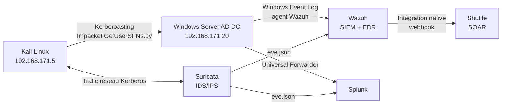

Trois VMs VirtualBox sur un réseau host-only isolé (`192.168.171.0/24`), chaque machine ayant une seconde carte NAT pour l'accès internet :

| Machine | Rôle | IP |
|---|---|---|
| Kali Linux | Attaquant | 192.168.171.5 |
| Windows Server 2022 | Contrôleur de domaine cible | 192.168.171.20 |
| Ubuntu Server | Hôte Docker (Wazuh, Splunk, Suricata, Shuffle) | 192.168.171.4 |

<p align="center">
  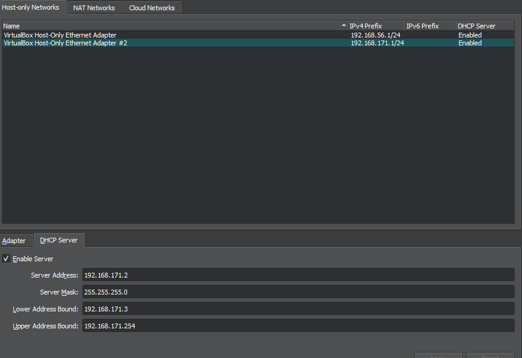
  <br/><sub>Réseau host-only isolé (192.168.171.0/24) créé dans VirtualBox pour cloisonner le lab</sub>
</p>

## Stack technique

| Brique | Outil | Rôle |
|---|---|---|
| SIEM / EDR | Wazuh 4.14.7 (Docker) | Agrégation de logs Windows, détection par règles, agent endpoint |
| SIEM complémentaire | Splunk 8.2.12 (Docker) | Agrégation et requêtage SPL, comparaison multi-SIEM |
| IDS/IPS | Suricata 8.0.8 (Docker, `network_mode: host`) | Détection réseau, parsing protocolaire Kerberos natif |
| SOAR | Shuffle (Docker) | Automatisation déclenchée par les alertes Wazuh |

## Scénario d'attaque : Kerberoasting

Un attaquant authentifié dans le domaine (`yves`) cible un compte de service (`test`, SPN `MSSQLSvc/dc01.lab.local:1433`) pour en récupérer le hash Kerberos et tenter de le casser offline — [MITRE ATT&CK T1558.003](https://attack.mitre.org/techniques/T1558/003/).

```bash
python3 GetUserSPNs.py lab.local/yves:Azerty1234! -dc-ip 192.168.171.20 -request
```

<p align="center">
  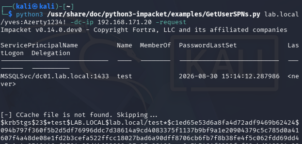
  <br/><sub>Récupération du hash Kerberos (<code>$krb5tgs$</code>) du compte de service <code>test</code> depuis Kali, prêt pour un crack offline</sub>
</p>

### Détection côté Wazuh (EDR/SIEM)
- Event Windows **4769** (demande de ticket de service), avec `TicketEncryptionType: 0x17` (RC4 — signal fort de Kerberoasting, les comptes modernes utilisant AES)
- Déclenchement de la règle **92652** (NTLM / possible pass-the-hash) sur le mouvement latéral associé, taggée MITRE `T1550.002`

<p align="center">
  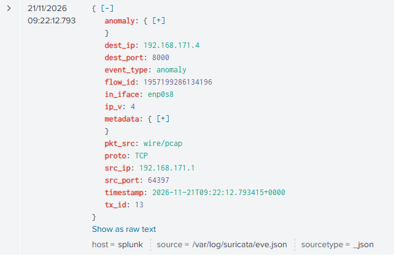
  <br/><sub>Event 4769 côté DC : ticket demandé pour le SPN `test` avec chiffrement RC4 (0x17) — la signature du Kerberoasting</sub>
</p>
<p align="center">
  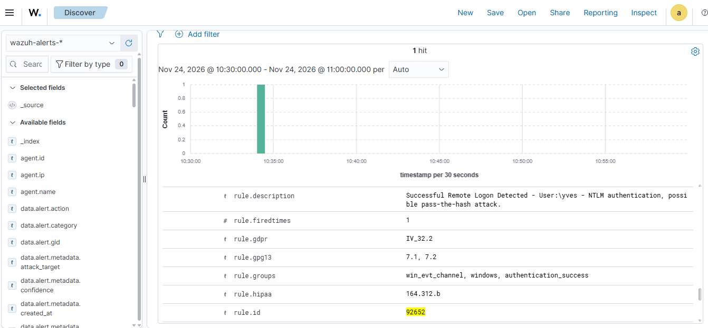
  <br/><sub>Règle Wazuh 92652 déclenchée dans le dashboard : "Successful Remote Logon Detected - User:\yves - NTLM authentication, possible pass-the-hash attack"</sub>
</p>

### Détection côté Suricata (IDS réseau)
- **SID 2226001** : `SURICATA Kerberos 5 weak encryption parameters` : détecte le chiffrement RC4 faible directement sur le câble, indépendamment des logs Windows
- **SID 2019922** : `ET EXPLOIT Possible GoldenPac Priv Esc in-use` : signature plus large qui matche aussi la structure des requêtes Impacket

<p align="center">
  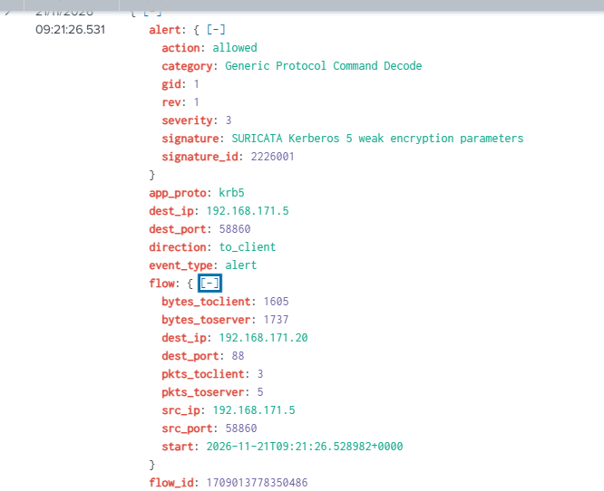
  <br/><sub>Alerte Suricata (SID 2226001) déclenchée sur le trafic Kerberos capturé en direct sur le câble</sub>
</p>

### Corrélation croisée
Les logs Suricata (`eve.json`) remontent simultanément vers Wazuh et Splunk, permettant de retrouver la même attaque sous trois angles différents dans trois outils distincts — exactement le réflexe qu'on attend d'un analyste SOC pour confirmer une détection sans dépendre d'une seule source.

### Réponse automatisée (SOAR)
L'intégration native Wazuh → Shuffle déclenche un workflow dès que la règle 92652 se déclenche, transmettant l'alerte complète (règle, agent, données Windows brutes) vers un webhook Shuffle qui peut ensuite enrichir, notifier ou escalader automatiquement.

<p align="center">
  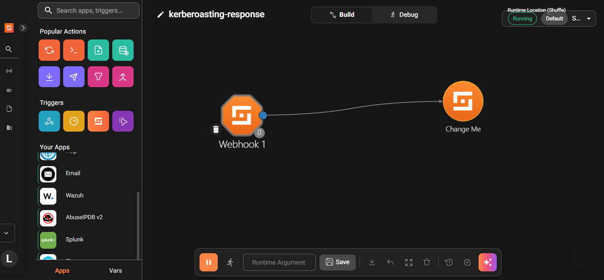
  <br/><sub>Workflow Shuffle "kerberoasting-response" : Webhook déclenché par Wazuh → traitement de l'alerte</sub>
</p>

<p align="center">
  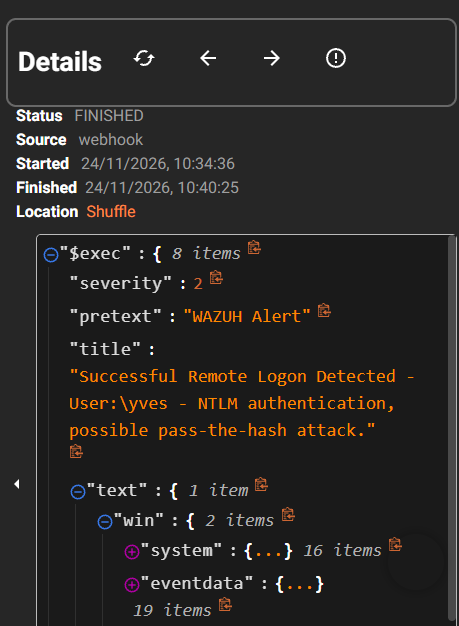
  <br/><sub>Chaîne complète confirmée de bout en bout : l'alerte Wazuh réelle (règle 92652, données Windows) arrive dans Shuffle, pas un payload de test</sub>
</p>

## Ce que ce projet démontre (au-delà d'un tutoriel)

La majorité du travail sur ce lab a été du **troubleshooting réel**, pas de la config qui marche du premier coup, ce qui, à mon sens, est la partie la plus proche de ce que vit un analyste SOC au quotidien :

- **Event Wazuh perdu sous charge** : l'agent Windows a occasionnellement "sauté" l'event 4769 précis de l'attaque sous forte rafale d'événements simultanés : diagnostiqué en comparant le volume d'événements 4769 vus par Windows (Event Viewer) face à ce qui remonte réellement dans Wazuh Discover, plutôt qu'en se contentant de "je ne vois rien dans le dashboard"

<p align="center">
  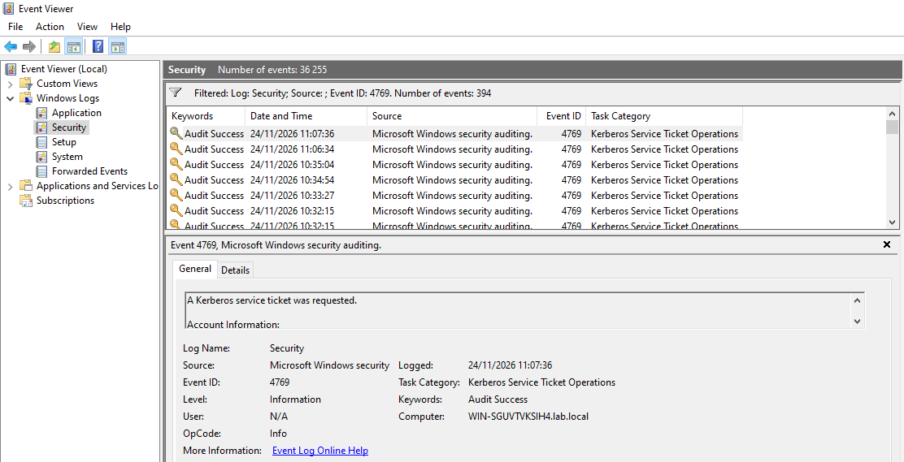
  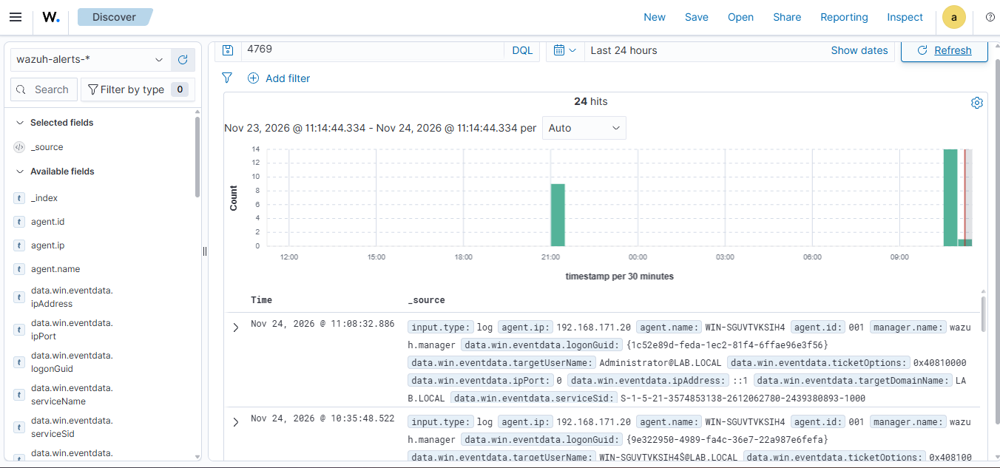
  <br/><sub>Méthode de diagnostic : comparer le log source (Event Viewer, à gauche) et ce qui est effectivement indexé côté Wazuh (Discover, à droite) pour détecter une perte silencieuse</sub>
</p>

- **Isolation réseau host-only** : le switch virtuel VirtualBox ne réplique pas le trafic unicast entre deux VMs invitées vers une troisième : Suricata ne voyait aucun paquet Kerberos tant que le mode promiscuité n'était pas activé des deux côtés (hyperviseur + interface Linux)

```
$ sudo tcpdump -i enp0s8 port 88 -n -v
11:07:20.330396 IP 192.168.171.5.56758 > 192.168.171.20.88: Flags [S] ...
11:07:20.330396 IP 192.168.171.20.88 > 192.168.171.5.56758: Flags [S.] ...
11:07:20.330396 IP 192.168.171.5.56758 > 192.168.171.20.88: Flags [P.], length 174   # requête TGS Kerberos
11:07:20.330396 IP 192.168.171.20.88 > 192.168.171.5.56758: Flags [P.], length 179   # réponse du DC
27 packets captured, 0 packets dropped by kernel
```
<p align="center"><sub>Trafic Kerberos (port 88) enfin visible sur l'interface <code>enp0s8</code> une fois le mode promiscuité activé</sub></p>
- **Dérive d'horloge Kerberos** : `KRB_AP_ERR_SKEW` entre Kali et le DC après plusieurs redémarrages de VM, corrigé par synchronisation NTP manuelle

- **Incompatibilité matérielle silencieuse** : Splunk récent plante en boucle sur un CPU sans AVX à cause de son MongoDB interne (KVStore) : un comportement non documenté clairement, découvert en lisant les logs Ansible internes du conteneur
  
- **Vérification SSL codée en dur** : l'intégration native Wazuh → Shuffle échouait silencieusement sur le certificat auto-signé de Shuffle ; corrigé en patchant directement le script Python (`verify=False`) après avoir tracé l'erreur jusqu'au niveau debug du module d'intégration
  
- **Mauvaise configuration Swarm** : Shuffle configuré par défaut pour Docker Swarm sans qu'aucun cluster Swarm n'existe, bloquant silencieusement l'exécution des workflows

<p align="center">
  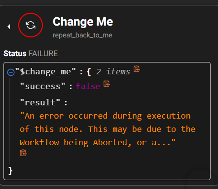
  <br/><sub>Premier symptôme : le nœud "Change Me" échoue systématiquement : Orborus tentait de dispatcher en mode Swarm sans cluster configuré</sub>
</p>
<p align="center">
  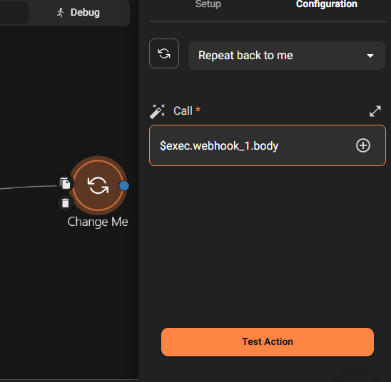
  <br/><sub>Autre piège : une syntaxe de variable incorrecte (`$exec.webhook_1.body` au lieu de `$exec.test`) empêchait aussi de récupérer le payload du webhook</sub>
</p>

## Compétences mobilisées

- Administration Active Directory (comptes de service, SPN, stratégies d'audit avancées, Kerberos)
- Déploiement et troubleshooting Docker/Docker Compose multi-services
- Lecture et interprétation de logs bas niveau (Windows Event Log, OpenSearch, Ansible, Python)
- Détection réseau (signatures Suricata, protocole Kerberos)
- Corrélation multi-sources (SIEM/EDR/IDS)
- Automatisation SOAR (intégrations natives, webhooks, workflows)

## Prochaines étapes possibles

- Ajouter une règle de détection Wazuh custom basée sur `ticketEncryptionType` plutôt que sur la règle générique NTLM
- Enrichir le workflow Shuffle avec une app d'enrichissement IOC (AbuseIPDB, VirusTotal)
- Étendre le scénario à DCSync et au mouvement latéral complet
